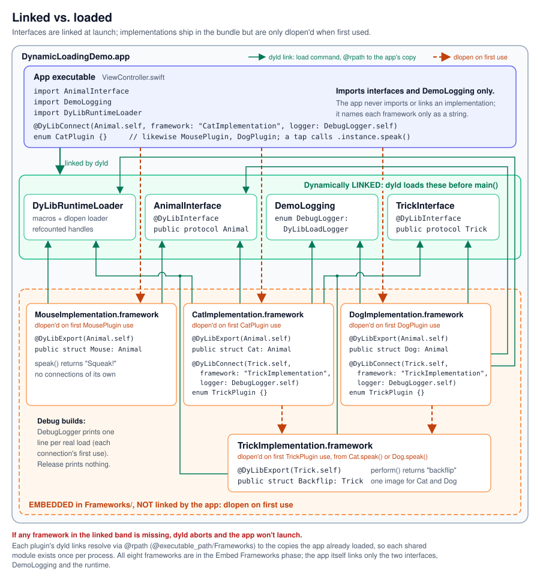
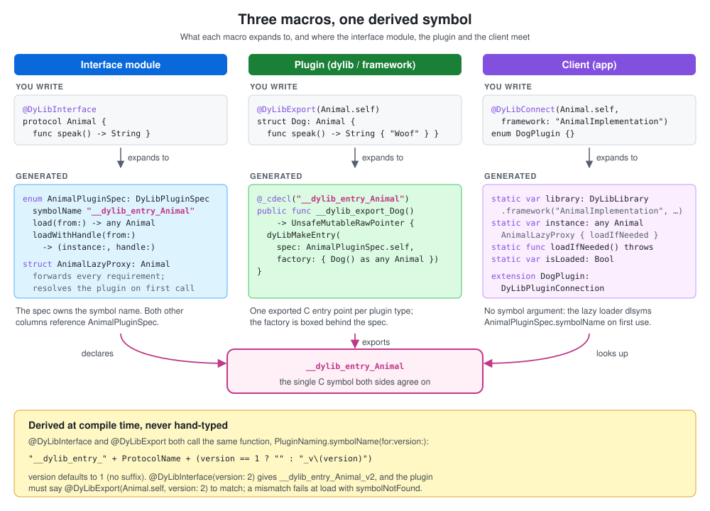
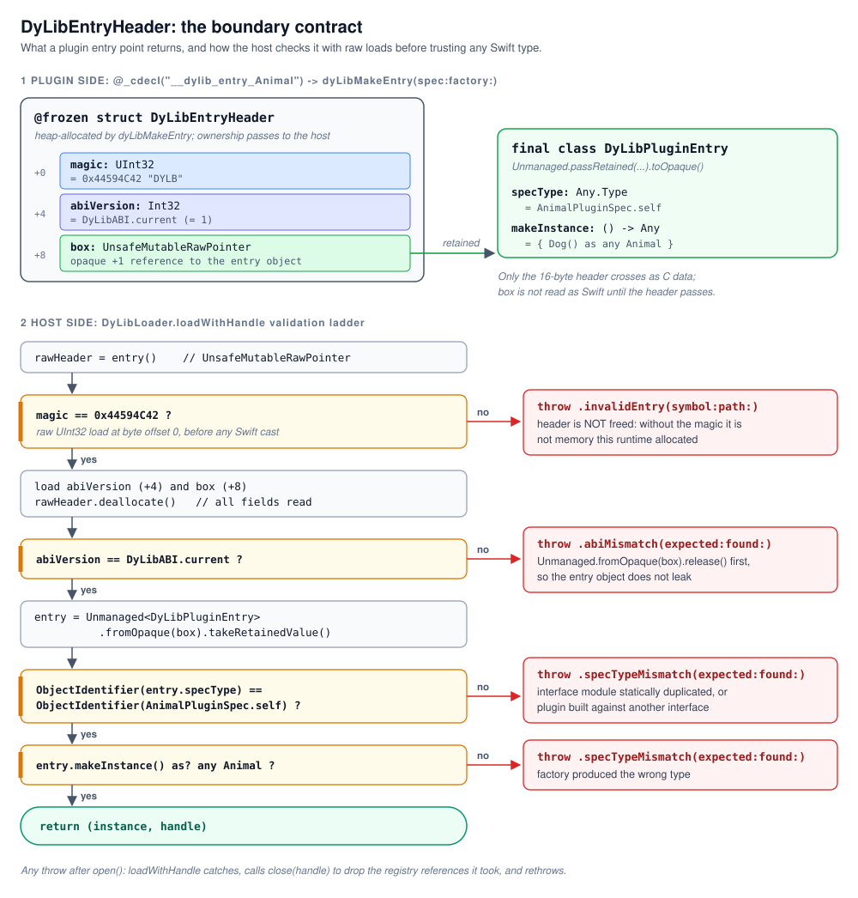
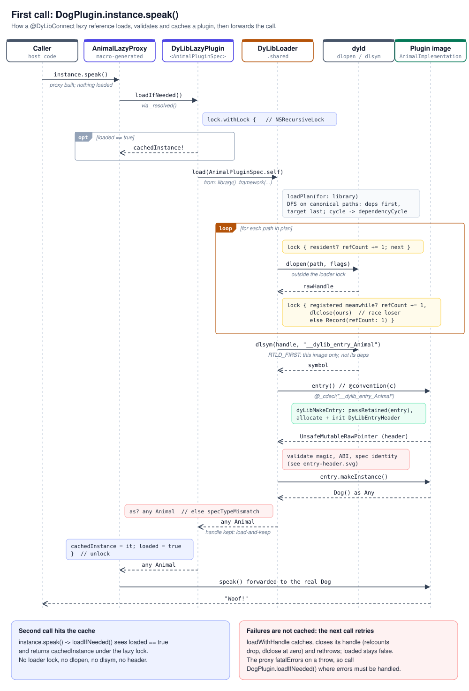
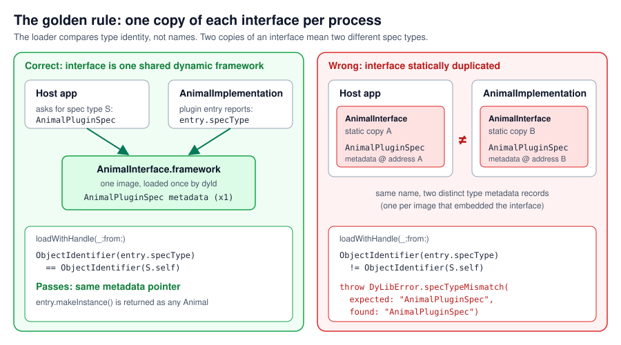
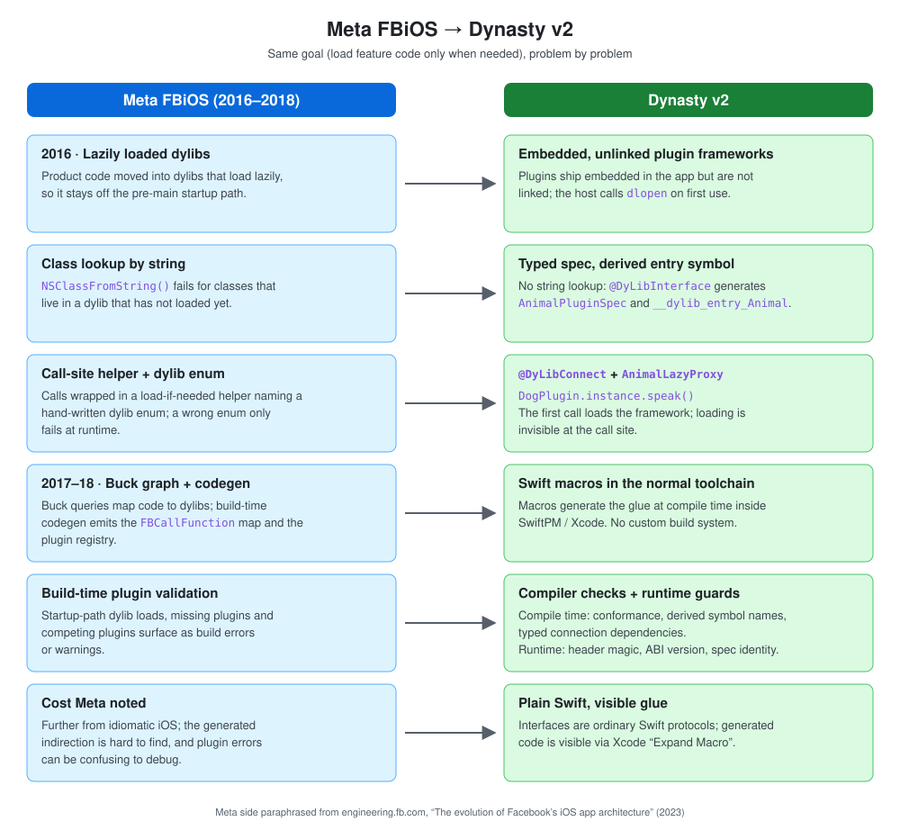

# DyLibRuntimeLoader

Type-safe plugins for Swift on iOS and macOS: ship feature code as embedded dynamic frameworks that are **linked by nobody and loaded on first use**, with three Swift macros generating every symbol, entry point, and loader call so that the compiler, not a string, checks the wiring.


**Platforms:** iOS 13+ · macOS 10.15+ · Swift 6 toolchain (`swift-tools-version: 6.0`)

```swift
@DyLibConnect(Animal.self, framework: "AnimalImplementation")
enum DogPlugin {}

print(DogPlugin.instance.speak())   // AnimalImplementation.framework is dlopen'd here, not at launch
```

## Contents

- [Why dynamic loading](#why-dynamic-loading)
- [The pattern: interface, plugin, connection](#the-pattern-interface-plugin-connection)
- [What the macros generate](#what-the-macros-generate)
- [Conformance: what makes a plugin valid](#conformance-what-makes-a-plugin-valid)
- [What happens on the first call](#what-happens-on-the-first-call)
- [The golden rule: one copy of every shared module](#the-golden-rule-one-copy-of-every-shared-module)
- [A modern take on Meta's FBiOS dylibs and plugins](#a-modern-take-on-metas-fbios-dylibs-and-plugins)
- [Usage patterns](#usage-patterns)
- [Setting up an iOS app](#setting-up-an-ios-app)
- [App Store review](#app-store-review)
- [Reference](#reference): errors, unloading, repository layout, development, migration from v1

## Why dynamic loading

Apps can use another binary in three ways. **Static linking** copies the code into the executable. **Dynamic linking** records the framework as a load command, so dyld maps, rebases, and binds it *before `main()`* on every launch whether or not the session uses it. **Dynamic loading** asks for the image later with `dlopen`, only when a feature needs it.

DyLibRuntimeLoader builds on the third. The app links only small **interface modules** (protocols) and the runtime. Concrete implementations live in frameworks that are *embedded* in the bundle but *not linked*, and they are opened the first time someone calls into them.



That buys you:

- **Launch time.** Feature code is off the pre-main path. A framework that is never used this session is never mapped.
- **Decoupling.** The app imports `AnimalInterface`, never `Dog`. Implementations can be internal types and change without rebuilding the host, which is the [interface-module](https://swiftrocks.com/reducing-ios-build-times-by-using-interface-targets) build-time win, applied at runtime.
- **Failure isolation.** A missing linked framework kills the process at launch. A missing plugin only produces a `DyLibError.failedToOpen` when (and if) it is requested.

## The pattern: interface, plugin, connection

Every plugin system built with this library has exactly three roles, each marked by one macro.

**1. Interface module** (a `.dynamic` library shared by host and plugins):

```swift
import DyLibRuntimeLoader

@DyLibInterface
public protocol Animal {
    func speak() -> String
}
```

**2. Plugin** (a framework that implements the interface; nobody links it):

```swift
import AnimalInterface
import DyLibRuntimeLoader

@DyLibExport(Animal.self)
public struct Dog: Animal {
    public init() {}
    public func speak() -> String { "Woof!" }
}
```

**3. Connection** (in the host app, or in another plugin):

```swift
import AnimalInterface
import DyLibRuntimeLoader

@DyLibConnect(Animal.self, framework: "AnimalImplementation")
enum DogPlugin {}

let message = DogPlugin.instance.speak()
```

That is the whole surface for the common case. There is no registry to populate, no manager to activate, no identifier string, and no symbol name anywhere in user code.

## What the macros generate



| Macro | Attached to | Generates |
| --- | --- | --- |
| `@DyLibInterface(version: Int = 1, proxy: Bool = true)` | a top-level protocol `P` | `PPluginSpec`: the typed loader (`load(from:)`, `loadWithHandle(from:)`) and the entry symbol name. `PLazyProxy: P`: a value that forwards every requirement through a lazy resolver. |
| `@DyLibExport(P.self, version: Int = 1)` | a top-level, non-generic type conforming to `P` | `@_cdecl("__dylib_entry_P") func __dylib_export_<Type>()`, which returns a boundary header wrapping a factory `{ Type() as any P }`. |
| `@DyLibConnect(P.self, framework:, dependencies: [], bundle: nil)` | a namespace `enum` | `library`, `instance: any P` (a `PLazyProxy`), `loadIfNeeded()`, `isLoaded`, and conformance to `DyLibPluginConnection`. |

The entry symbol is **derived, never typed**: `__dylib_entry_<Protocol>` for version 1 and `__dylib_entry_<Protocol>_v<N>` otherwise. Both sides compute it from the same protocol name and version, so the host's `dlsym` and the plugin's `@_cdecl` cannot drift apart through a typo. You can inspect any expansion in Xcode with **Editor ▸ Expand Macro**.

## Conformance: what makes a plugin valid

A plugin "conforms" at two levels: Swift conformance, which the compiler checks, and boundary conformance, which the loader checks before trusting anything in the image.

**Checked at compile time**

- The exported type conforms to the interface (`Dog() as any Animal` must type-check).
- It has an accessible zero-argument `init()`.
- It is a top-level, non-generic type, and `@DyLibInterface` is on a top-level protocol. Violations are named macro diagnostics, not linker errors.
- The connection's dependencies are *types* (`[TrickPlugin.self]`), so a misspelled dependency does not compile.

**Checked at load time, in this order**

Every entry point returns a pointer to a fixed, C-layout header. The host reads it with raw loads, so it never interprets an unknown pointer as a Swift object:



1. **Symbol present.** `dlsym` on the target image only (`RTLD_FIRST`) must find the derived entry symbol, or the load fails with `symbolNotFound`. This is how version bumps fail loudly.
2. **Magic.** The header's first field must be `0x44594C42` ("DYLB"), or the load fails with `invalidEntry`. The pointer is *not* freed, because the runtime did not allocate it.
3. **ABI version.** It must equal `DyLibABI.current`, or the load fails with `abiMismatch`.
4. **Spec identity.** `ObjectIdentifier(entry.specType) == ObjectIdentifier(AnimalPluginSpec.self)`, or the load fails with `specTypeMismatch`. This catches a wrong-spec entry *and* a statically duplicated interface module (see [the golden rule](#the-golden-rule-one-copy-of-every-shared-module)).
5. **Cast.** The factory's value must cast to `any Animal`.

**Evolving an interface.** A plugin built against an *older* version of the same, correctly shared interface module keeps the same metadata identity, so step 4 cannot see it. When you add or change requirements, bump the version on both sides, for example `@DyLibInterface(version: 2)` and `@DyLibExport(Animal.self, version: 2)`. The new symbol is `__dylib_entry_Animal_v2`, and a stale plugin fails at step 1 with `symbolNotFound` instead of being called through a stale witness table. Swift library evolution is the advanced alternative when independently built images must stay compatible.

## What happens on the first call



- `DogPlugin.instance` is a cheap, stateless `AnimalLazyProxy`. Creating it loads nothing.
- The first requirement call goes through `DyLibLazyPlugin.loadIfNeeded()`. Concurrent first calls collapse into one load, and later calls hit the cached instance.
- `DyLibLoader` computes a topological plan over `dependencies`, opens each image once in a process-wide, reference-counted registry keyed by canonical path, and never calls `dlopen` while holding its lock (image initializers may take locks of their own).
- **Failures are not cached.** If the framework is missing, the next call retries.
- How a failure surfaces depends on the requirement. `throws` and `async throws` requirements rethrow the `DyLibError`. A non-throwing requirement has no way to report one, so the proxy traps with the interface name and the error text. When you need to handle a missing plugin gracefully, call `try DogPlugin.loadIfNeeded()` first.

## The golden rule: one copy of every shared module

Every interface module and `DyLibRuntimeLoader` itself **must be a `.dynamic` library product, embedded once and shared by the host and every plugin. Never link them statically.**



Swift type identity is *metadata* identity, not the spelling `AnimalInterface.Animal`. Two static copies of the same source produce two distinct protocol and spec metadata records, so a value crossing the boundary is not the type the host thinks it is. The spec identity check turns that silent corruption into an immediate `specTypeMismatch`. In `Package.swift`:

```swift
.library(name: "AnimalInterface", type: .dynamic, targets: ["AnimalInterface"])
```

## A modern take on Meta's FBiOS dylibs and plugins

Meta's [The evolution of Facebook's iOS app architecture](https://engineering.fb.com/2023/02/06/ios/facebook-ios-app-architecture/) describes the path this library follows:

- **2016.** Pre-main time had grown with every product, so FBiOS moved product code into lazily loaded dylibs. That caused new problems. `NSClassFromString` failed for classes in unloaded dylibs. Call sites had to wrap calls in a helper that took a hand-maintained dylib enum, and choosing the wrong one only failed at runtime.
- **2017–2018.** Using Buck's dependency graph, they generated a function-and-class-to-dylib map at build time, and on top of it a **plugin** system validated by the build, which hid dylibs from most engineers.
- **Costs they report.** Plugin errors that are hard to search for, a departure from idiomatic iOS development, and an extra layer of indirection in a generated registry that is hard to find.

DyLibRuntimeLoader keeps the idea and replaces the infrastructure with language features every Swift developer already has:



| FBiOS | DyLibRuntimeLoader v2 |
| --- | --- |
| Product code in lazily loaded dylibs, off the pre-main path | Plugins are embedded, unlinked frameworks, opened with `dlopen` on first use |
| String lookups (`NSClassFromString`) fail across unloaded dylibs | No string lookup: macro-derived C entry symbols and typed `PluginSpec`s |
| Helper call with a hand-written dylib enum, wrong value fails at runtime | `@DyLibConnect` plus a generated lazy proxy: `DogPlugin.instance.speak()`, loading is invisible |
| Custom build system (Buck) plus codegen for the dylib map and plugin registry | Swift macros generate the glue inside stock SwiftPM and Xcode |
| Build-time plugin validation | Compiler-checked conformance, derived symbols, and typed dependencies, plus runtime magic, ABI, and identity checks |
| Non-idiomatic, generated registry hard to find | Plain Swift protocols, and generated code is one **Expand Macro** away |

The original v1 of this library mimicked the 2016 stage: handwritten `@_cdecl` strings and untyped casts. v2 is the 2018 stage, without the custom build system.

## Usage patterns

**Plugins that load plugins.** A connection works anywhere, including inside a plugin. The demo's `Cat` and `Dog` each lazily load a `Trick` plugin only when they speak (`Mouse` uses none):

```swift
@DyLibConnect(Trick.self, framework: "TrickImplementation")
enum TrickPlugin {}

@DyLibExport(Animal.self)
public struct Dog: Animal {
    public init() {}
    public func speak() -> String { "Woof! (and does a \(TrickPlugin.instance.perform()))" }
}
```

**Declared dependencies.** When an image needs another image opened first, list its connections. They become `DyLibLibrary` dependencies and open in topological order. A cycle throws `dependencyCycle` with its path.

```swift
@DyLibConnect(Animal.self, framework: "AnimalImplementation", dependencies: [TrickPlugin.self])
enum DogPlugin {}
```

**Explicit paths, without a connection.** Load any image directly, for example in a macOS host or a test:

```swift
let cat = try AnimalPluginSpec.load(from: catPath)

let dog = try AnimalPluginSpec.load(from: DyLibLibrary(
    path: dogPath,
    dependencies: [DyLibLibrary(path: trickPath)]
))
```

**Graceful failure.** `try DogPlugin.loadIfNeeded()` returns the instance or throws, and `DogPlugin.isLoaded` reports whether it is cached.

**Proxy-less interfaces.** Lazy proxies cannot forward initializer or static requirements, `mutating` methods, settable properties, subscripts, or associated types. The macro names the offending requirement and skips the proxy. Use `@DyLibInterface(proxy: false)` for such interfaces and call `loadIfNeeded()` instead of `instance`.

**Open flags.** `DyLibLibrary` defaults to `[.now, .local, .first]`. `RTLD_FIRST` confines symbol lookup to the requested image rather than its dependencies. The registry is keyed by canonical path, so the first open's flags win while the image stays resident.

### Logging lazy loads

To see when a plugin actually loads and how long the first call waited, give the connection a `DyLibLoadLogger` type. It is a type, not an instance, so it is a plain compile-time argument like the interface:

```swift
enum PluginLog: DyLibLoadLogger {
    static let log = Logger(subsystem: "com.example.app", category: "plugins")

    static func didLoad(_ event: DyLibLoadResult) {
        let outcome = event.error.map { "failed: \($0)" } ?? "ok"
        log.info("Loaded \(event.interface) from \(event.path) in \(event.duration)s: \(outcome)")
    }
}

@DyLibConnect(Animal.self, framework: "AnimalImplementation", logger: PluginLog.self)
enum DogPlugin {}
```

- One event per **real load**. Cache hits are silent, and because failures are not cached, each retry produces its own event.
- `didLoad` fires on success and on failure, so a load that is about to trap a non-throwing proxy requirement is logged first. `willLoad` is optional and defaults to a no-op.
- `duration` is in seconds on the monotonic uptime clock, from the first call to a usable instance, covering `dlopen` of the image and its dependencies, the symbol lookup, header validation, and the factory call.
- Leave `logger:` out and nothing is logged; the connection expands exactly as before and reads no clock. There is no global logger, so two connections can log differently.
- Callbacks run outside `DyLibLoader`'s lock but inside the connection's own, so a logger must not call into the connection it is logging.

## Setting up an iOS app

### How the app packages interfaces vs. implementations

Both kinds of framework end up in the same place, `YourApp.app/Frameworks/`, signed with the app. What differs is whether the app binary *references* them. Embedding copies a framework into the bundle; linking adds an `LC_LOAD_DYLIB` load command that makes dyld open it before `main()`. Interfaces get both. Implementations get only the first.

| | Interface modules and the runtime | Implementations (plugins) |
| --- | --- | --- |
| Examples in the demo | `DyLibRuntimeLoader`, `AnimalInterface`, `TrickInterface`, `DemoLogging` | `CatImplementation`, `MouseImplementation`, `DogImplementation`, `TrickImplementation` |
| How it enters the project | Swift package with a `.dynamic` library product | Framework target in the app project (or a prebuilt `.xcframework`) |
| Link Binary With Libraries | **Yes** | **No** |
| Embed Frameworks (Code Sign On Copy) | Yes | Yes |
| `import`ed by app code | Yes, the app calls the protocols | **Never**, the app names it only as a string in `@DyLibConnect(framework:)` |
| Load command in the app binary | Yes | None (`otool -L` won't list it) |
| When it is mapped | By dyld at launch, before `main()` | By `dlopen` on the first call through its connection |
| If it is missing from the bundle | The app cannot launch | The app launches; that connection throws `failedToOpen` when used |
| Copies per process | Exactly one, shared by the app and every plugin | One, opened once and reference-counted by `DyLibLoader` |

A few details make this work:

- **Build order without linking.** The app target lists each implementation as a *target dependency* so Xcode builds it before the Embed Frameworks phase copies it, but the link phase never mentions it.
- **Plugins link interfaces, never each other.** Each implementation links the interfaces it uses and the runtime, which is how it resolves `Animal`, `Trick`, and `DebugLogger` to the app's single copies through `@rpath` (`@executable_path/Frameworks`). Linking against a `.dynamic` product records a load command but copies nothing, so the plugin doesn't carry its own interface copy. A plugin reaches another plugin only through a connection (`Dog` → `TrickImplementation`), never by linking it.
- **Only the app embeds.** Plugins don't embed their dependencies. The app embeds every framework exactly once, which is [the golden rule](#the-golden-rule-one-copy-of-every-shared-module) applied to packaging.

### Steps

The [demo](Demo/DynamicLoadingDemo) shows the full setup:

1. Add the runtime and each interface module as Swift packages (`AnimalInterface`, `TrickInterface`, and `DemoLogging`, which holds the shared `DebugLogger`). They are `.dynamic` products, so they are **linked and embedded**.
2. Add each implementation as a **framework target** (`CatImplementation`, `MouseImplementation`, `DogImplementation`, `TrickImplementation`) that depends on its interface. `Cat` and `Dog` also depend on `TrickInterface` and `DemoLogging` because they declare their own `Trick` connection.
3. In the app target's **Embed Frameworks** build phase, add the implementation frameworks, but do **not** add them to *Link Binary With Libraries* and do not `import` them. This puts them in `YourApp.app/Frameworks/` with no load command in the app binary.
4. Declare `@DyLibConnect(Animal.self, framework: "CatImplementation", logger: DebugLogger.self)` (and likewise for `Mouse` and `Dog`) and call through `instance`. `DyLibLibrary.framework(_:)` resolves `Frameworks/<Name>.framework/<Name>`, including the macOS `Contents/Frameworks` layout.

The app's `Frameworks/` folder then contains `DyLibRuntimeLoader`, `AnimalInterface`, `TrickInterface`, and `DemoLogging` (linked), plus `CatImplementation`, `MouseImplementation`, `DogImplementation`, and `TrickImplementation` (not linked; `otool -L` on the app binary never lists them). Nothing loads at launch. Tapping **Run Cat**, **Run Mouse**, or **Run Dog** performs that animal's first `dlopen`, and in Debug builds `DebugLogger` prints a line such as `[DyLib] Animal from CatImplementation in 12.06 ms (ok)`, followed by one for `Trick` when `Cat` or `Dog` speaks. A second tap is a cache hit and prints nothing.

To see the difference, delete `CatImplementation.framework` from a simulator build's `Frameworks/` folder and relaunch. The app starts normally and fails only when **Run Cat** is tapped. Delete `AnimalInterface.framework` and the app cannot launch at all.

## App Store review

Dynamic loading as this library does it uses only public, documented APIs (`dlopen`, `dlsym`, `dlclose` from `<dlfcn.h>`) on frameworks that are **built, signed, and embedded in the app you submit**. That is the same set of code App Review sees. The relevant rule is [App Store Review Guideline 2.5.2](https://developer.apple.com/app-store/review/guidelines/#software-requirements): apps must be self-contained in their bundles and may not download, install, or execute code that introduces or changes features or functionality.

So the line is clear:

| ✅ Compatible | ❌ Not allowed |
| --- | --- |
| Loading frameworks that ship inside the submitted `.app` bundle | Downloading a `.framework` or `.dylib` after install and loading it |
| Choosing *when* to load (lazily, on first use) | Replacing or patching shipped binaries to change behavior after review |
| Choosing *which* bundled plugin to load (feature flags, A/B tests among reviewed code) | Using plugins to hide functionality from review |

Notes for shipping:

- **Code signing is enforced on device.** Every embedded framework is signed with the app and checked by the kernel when mapped. On a device, a modified or swapped framework will not load. That differs from the simulator, which does not enforce signatures in the same way, so do not mistake simulator tampering for a deployment strategy.
- **Embed with "Code Sign On Copy"** (Xcode's default for Embed Frameworks), and include every plugin in the archive you submit.
- **`DyLibLibrary(path:)` is for development and tests** on macOS or the simulator. In a shipping iOS app, resolve plugins inside the bundle with `@DyLibConnect` or `DyLibLibrary.framework(_:)`.
- **Mind the launch-time trade-off.** Apple recommends keeping the number of embedded dynamic frameworks small, because each linked one costs launch time. Unlinked plugins don't add to launch, but each still adds bundle size and a `dlopen` on first use, so group related features into one plugin rather than shipping many tiny ones.

## Reference

### Errors

All loader failures are `DyLibError`:

| Case | When it fires |
| --- | --- |
| `failedToOpen(path:reason:)` | `dlopen` cannot open an image, for example because the path is missing or the binary is incompatible. |
| `symbolNotFound(symbol:path:)` | The image opened, but the derived entry symbol is absent (wrong interface, or a version mismatch). |
| `invalidEntry(symbol:path:)` | The entry returned a header with the wrong magic value. |
| `abiMismatch(expected:found:)` | The plugin's entry reports a different `DyLibABI` version from the runtime. |
| `specTypeMismatch(expected:found:)` | The spec metadata is not identical to the host's, or the factory value cannot be cast to the interface. This catches wrong-spec entries and duplicated interface modules. |
| `dependencyCycle(path:)` | A `DyLibLibrary` dependency graph contains a cycle. |
| `notLoaded(path:)` | An operation received a closed, stale, or otherwise unregistered handle. |

### Unloading

`load(from:)` follows a load-and-keep policy and discards its handle. When explicit release is required, use `loadWithHandle(from:)` and pass the handle to `DyLibLoader.shared.close(_:)` only after the instance and every other value, closure, and metadata reference from that image is gone. Unloading Swift code that is still referenced is undefined behavior.

### Repository layout

```text
.
├── Sources/
│   ├── DyLibRuntimeLoader/         Runtime, public macros, loader, deprecated v1 adapters
│   └── DyLibRuntimeLoaderMacros/   SwiftSyntax implementations of the three macros
├── Tests/                          Runtime and macro tests (enabled with DYLIB_DEV=1)
├── Examples/                       SwiftPM end-to-end example: two interfaces, three plugins, one host
│   └── run.sh                      Builds, assembles, runs, and verifies the output
├── Demo/                           iOS app: three animal plugins, a trick plugin, and a shared DebugLogger, loaded on tap
└── docs/diagrams/                  Diagrams used in this README
```

### Run the example

```sh
git clone https://github.com/winstondu/DyLibRuntimeLoader.git
cd DyLibRuntimeLoader
Examples/run.sh
```

```text
Cat: Meow
Dog: Woof! (and does a backflip)
Expected output verified.
```

The script builds each package independently, then places the host next to exactly one copy of every shared dynamic library in `Examples/.dist`. That is the golden rule, made concrete.

### Developing and testing

```sh
swift build
DYLIB_DEV=1 swift test
```

`DYLIB_DEV=1` adds test targets, test-only dependencies, and unsafe linker flags only for maintainers, keeping them out of consumers' dependency resolution.

### Migration from v1

| Deprecated v1 API | v2 replacement |
| --- | --- |
| Handwritten `@_cdecl("symbol")` plus `dyLibCreator(factory:forType:)` | `@DyLibExport(Interface.self)` on the implementation |
| `dyLibLoad(withSymbol:fromPath:forType:)` | `InterfacePluginSpec.load(from: path)` |
| `dyLibLoad(withSymbol:fromFramework:forType:)` | `@DyLibConnect(Interface.self, framework:)`, or `InterfacePluginSpec.load(from: .framework(name))` |
| `dyLibLoad(fromPath:)` | `DyLibLoader.shared.open(DyLibLibrary(path: path))` |
| `dyLibLoad(fromFramework:)` | `DyLibLoader.shared.open(.framework(name))` |
| `FrameworkName` and `Directory` | `DyLibLibrary.framework(_:)` or `DyLibLibrary(path:dependencies:)` |
| `DynamicFrameworkLoaderError` | `DyLibError` |

## License

DyLibRuntimeLoader is available under the MIT License. See [LICENSE](LICENSE).

Originally created by [duyquang91](https://github.com/duyquang91) (Steve Dao).
